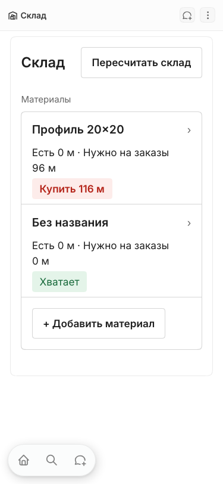
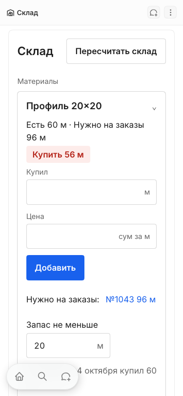
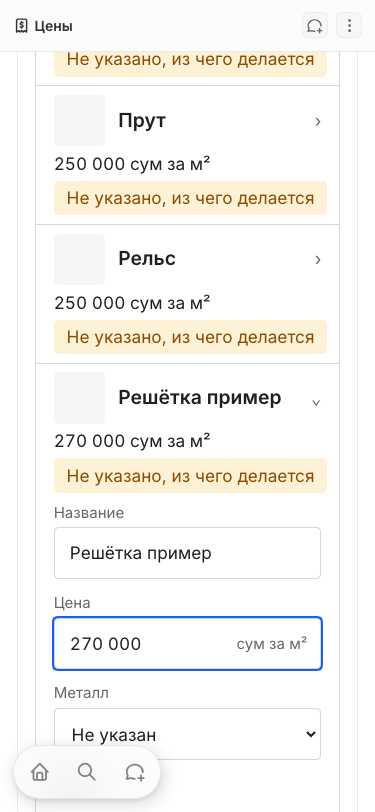
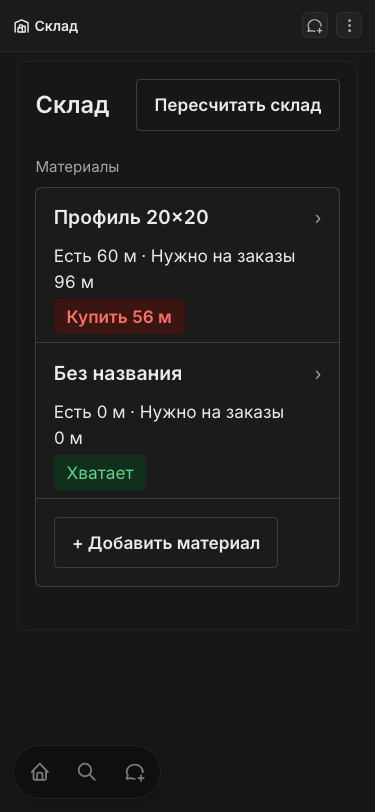
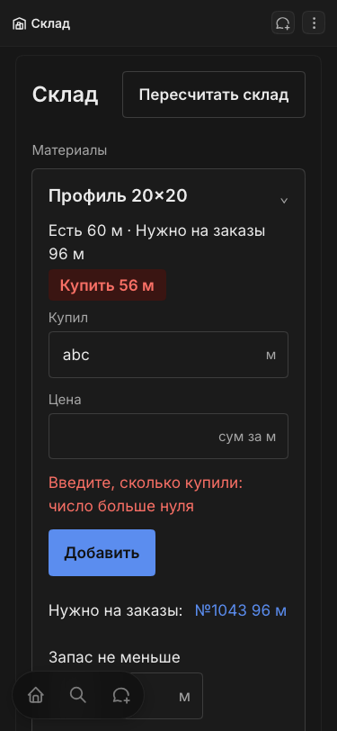
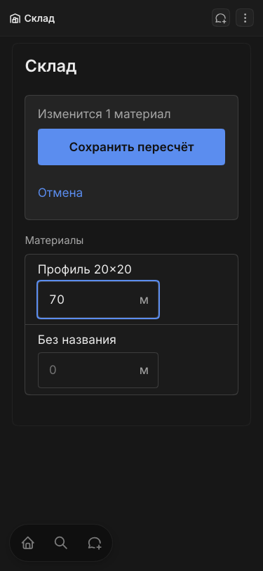
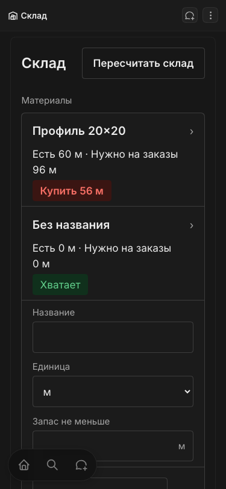

# PR C report: «Склад» (phase 1, Tasks 15 to 21)

Date: 2026-10-04. PR: https://github.com/farvater363-stack/claw-crm/pull/12 (head b3acbcce96, base main). Not merged; the merge is yours.

Merge command (merge commit, not squash):

    gh pr merge 12 --repo farvater363-stack/claw-crm --merge

Production was not touched. The runbook is ~/claw-private-docs/docs/runbooks/2026-10-04-phase-1-production.md.

## What was built

Ten commits on claude/simplify-1c-stock, 56 files, +3509 / -742.

- Task 15. Stock rules without a safety percent and without "available"; overuse from recounts (0fab390, b6449ce).
- Task 16. Order materials without the actual-consumption step; on-order-material-updated deleted (5fbe79c).
- Task 17. Pure logic for the screen: rows, purchase and recount checks; quantities accept plain numbers only (f2bd789, d2a7354).
- Task 18. The «Склад» screen, its page and menu item; old warehouse folder and three views removed (4ab12e7, 7703c44).
- Task 19. Contract: three fields and two movement kinds removed, labels renamed, workshop read-only on order materials, browser spec rewritten, integration tests updated; relabelled select options keep their ids (540cbad, 8c7137d).
- Task 20. First-time-user walk at 375 px. Nothing to fix; no commit.
- Task 21. Runbook, spec status line, memory note. Documents only.
- Fix wave after the whole-branch review (b3acbcc): retries send current values once (id plus upsert), a test that guards every select option id, access message, local-server guard in the spec clean-up.

Applied to the local server in six steps. Destroys: C1 33 (five menu items, three views with their parts, one logic function), C2 17 (three fields and their dependents, one column). Every destroy was a removed thing or its dependent. All other applies were changes only.

## The finding you should know about

Twenty identifies a select option by an id generated from its label. On an options update, stored values survive only for ids present before and after; other rows fall to the field default. The contract apply turned a test «Пересчёт» movement into «Купил» (the dump taken just before shows STOCKTAKE).

Fixed in 8c7137d: the four relabelled options carry the ids of their old labels. Checked on the running local server with your go-ahead: a relabel with pinned ids kept one movement of each kind, in both directions. A new test snapshots the id of all 62 options of the 13 select fields, so phase 2's status renames fail until pinned.

Two consequences:
- PR B on main relabelled «Нет нормы» without a pin. main at a0ee1d2 must never be applied to production on its own. With PR C merged it is safe.
- Correction to what I said mid-session: an unpinned relabel would not have written orders off twice. The sync upserts by a fixed id and would rewrite the same movement back to WRITE_OFF with today's date. The damage would have been wrong history, wrong dates and a lost overuse base.

## Test results (actual output is in test-output.txt next to this file)

| What | Result |
|---|---|
| Unit | 343 passed, 27 files |
| Typecheck | exit 0, no output |
| Lint | 0 warnings, 0 errors |
| Integration warehouse-orders | 2 passed |
| Integration warehouse | 1 passed |
| Integration recalc | 2 passed |
| Browser warehouse.spec | 11 passed (3.6 m) |
| Browser prices.spec | 5 passed (1.6 m) |
| Browser measurer-form, owner-dashboard, payroll, ux-fixes | 13 passed (4.0 m) |
| Browser no-external-requests | 1 passed |
| Browser measurement-flow | 5 passed, 1 failed (the known photo download case) |
| CI on the PR | pending when this was written |

Money on the local server, before the session and after everything: 84 orders and 133 positions, fingerprints identical (orders md5 8a1a0d3f…, positions md5 58a79103…, sum of totals 266 255 000 сум). The md5 values in the earlier ledger could not be re-run because their query text was never saved; I re-based the fingerprint on a form that I checked equal between the live database and the dump taken before PR B's contract apply.

## Screens

375 px, owner, first-time-user walk (light):

375 px, dark:

A measurer who opens the page by its address:

768 px light versions are in shots/ too. The dark screenshots were taken before the fix wave; the fix wave changed behaviour, not layout. The screenshots contain local data (order №1043, grille names) and are not in the PR.

## Fallbacks taken

- The recount bar sticks to the top of the screen, not the bottom the design spec §9 asks for, because Twenty's floating phone bar covers the bottom-left corner.
- Dates in «Последнее» read «3 октября» (design spec §6.2), not the wireframe's «3 окт».
- The row shows «Есть … · Нужно на заказы …» inline instead of column heads, because a wrapping row cannot keep columns aligned on a phone.
- Order names appear as stored, «№1043» without a space.
- The sidebar clean-up was done through the UI (edit mode), which could remove every item; no script was needed.

## Not verified

- The workshop («Цех») menu and redirect in a browser: no local user has that role. Covered by the roles unit test only.
- A manager's retry after a lost response (the update branch of the upsert): read from code; the browser case covers the owner.
- The lost-response path itself on the screen: the browser case aborts the request before the server, so it proves the corrected values, not de-duplication.
- Anything on production data.
- CI on PR #12 had not finished.

## Known gaps carried from the hand-off

- No local user has the «Цех» role (see above).
- Linear is not authorized in these sessions: no issue lookup and no progress comment was made.
- measurement-flow.spec.ts «manager attaches a design photo and downloads it back» still fails locally (empty download body). Not shown to be caused by this work, not shown to have passed before.
- The eight items waiting for your decision in pr-b-report.md are unchanged: wording, zero price, no undo for a composition row, no photo removal, money input, author address, design names in import-excel.py, the note on order №1043.

## New things waiting for you

1. Merge PR #12 (command above), after CI.
2. Wording that is not in the design spec: «Без названия», «Материалы» as the list heading, «Единица», «Введите название», «Склад ведут владелец и менеджер», «Количество (+ купил, − ушло на заказ)», «Посчитано (пересчёт)», «Заказ» as a link text for an order without a name.
3. The recount bar at the top instead of the bottom.
4. After the «Материалы» view is gone, a material can be renamed or removed only from its record page. Say if the screen should get rename and remove.
5. «Купить» will be lower on production by the removed safety percent for every material with a reserve, and «Уходит больше» stays empty until each material has had two recounts. Intended; tell whoever buys.
6. One nameless material on the local server, created by hand under your login at 16:36 today. I did not create it and left it.
7. All commits carry the author address mardon@msagroupllc.com (public repo), as before.
8. The ledger folder (evidence, DB dumps, browser scripts) is kept in the 1b worktree; delete it after the merge if you do not need it.

## Mistakes of mine in this session

- I started an integration run about a minute after resuming an implementer; an integration run syncs the working tree to the server. The next plan showed nothing of the unfinished fix had been applied.
- I told you an unpinned relabel would write orders off twice. That was wrong (see the correction above).

## Rulings I made

Every ledger line that contains "Ruling:", in order. Lines 1 to 26 are from the earlier sessions (PR A and PR B); the rest are from this one.

1. | 1 | own test vs own code | Plan test has no VIEW/OBJECT case though Step 1 mentions "the VIEW case" and spec §9 says per item type. Ruling: add VIEW (hidden target -> false, readable -> true) and OBJECT-unchanged cases — spec §9 — cost if wrong: two extra test cases. |
2. | 3 | kit vs spec §6.4 names (NumberField, SavedTick, PhotoGrid) | Ruling: plan's API (Field/TextInput/SelectInput, grid inline in Task 13) stands — design spec wins on wording/layout only — cost if wrong: renames. |
3. | 3 | TextInput `outline: none` vs design spec §10 "focus always visible, 2px accent" | Ruling: TextInput wrapper shows a 2px accent outline while focused (focus state) — accessibility basic — cost if wrong: 6 lines. Motion (§4.4) not built: nothing animates yet. |
4. Task 4 note: no user has the «Цех» role locally (Admin 2, Менеджер 1, Замерщик 1); the workshop menu cannot be checked by signing in. Ruling: verify owner, manager, measurer in the browser and report the workshop as not verified in the browser (role definition + unit test cover it) — creating a user on the shared server was not asked for — cost if wrong: one unverified role.
5. Task 2: implemented 8d050de (BASE bcc7154). Ruling: measurement-notes switches to the shared palette although its border gets stronger (#ebebeb -> #d6d6d6 light, #333333 -> #3d3d3d dark) — spec §6.4 "own PALETTE copies are deleted", design spec §4 "values are final" — cost if wrong: slightly darker dividers in the notes widget, two-line revert.
6. Task 2: Ruling: shared formatMoney also replaces the identical local copy in new-measurement (beyond the brief) — one formatter — cost if wrong: two-line revert.
7. Task 4: Ruling: add a server change in PR A — navigationMenuItem.targetObjectMetadataId toCompare: true, with a test — spec §7.3 says to relax the server "in the same change" if it does not accept a target object; the update handler already resolves universal relation ids generically; alternative (new ids for the three items) destroys three menu items, which the user said to ask about — cost if wrong: one-line core change to revert; production needs the server deployed before the apply or the three items stay visible to everyone (fails open). If the plan still shows no updates after this change: stop and ask the user.
8. PR A: Ruling: fix Important 1 in this PR (one fix dispatch, FIX_BASE 77b8eb4), together with the no-op OBJECT condition, the duplicate validator comment and a missing-permissions-entry test — spec §7.3 exists so roles never reach a screen that only fails — cost if wrong: a few more lines of core delta.
9. Task 5: Ruling: drop the materialNorm.name read-only row (and its assertion); the name stays writable like order names, the trigger restores it — the file's own comment states this constraint and a failing create is a silent-failure trap — deviates from spec §7.4 "computed fields stay read-only" for this one field — cost if wrong: a manager can overtype a composition row's name until the trigger rewrites it. Fix round 1 to dispatch AFTER the Task 6 implementer commits (same worktree). The next plan will list those fieldPermission rows (created at B1 by this task) as destroyed: that destroy is this task's own change.
10. Task 6: parked — Ruling: accept the interim gap, no fix round — Task 7 (next commit, same PR, nothing applied in between) moves demand off metal/metalSize, after which the two fields feed nothing — cost if wrong: none once Task 7 lands; if Task 7 were dropped the trigger fields must come back.
11. Task 9: Ruling: the planner keeps the brief's behaviour for catalog shapes the local data does not have (sized price rows ignored; a second generic row of one metal collapses into the first; a second row naming one design survives only as a variant; a row with neither design nor metal is skipped) and the Task 10 runner prints every price row the plan does not carry over, before anything is written — spec §8 does not define these shapes, the local catalog has none (6 rows: 3 generic, 3 design rows, no sizes), and stored money is protected by the write-back either way — cost if wrong: on a catalog that has such rows, the grille's price for FUTURE orders is the unsized or first-row number until the owner corrects it in «Цены»; the runbook must make a non-empty "not carried over" list a stop for the owner.
12. Task 9: Ruling: a tie in "most used metal" resolves by input order, and the Task 10 runner sorts every loaded list by id before planning so the dry run and the apply produce the same plan — the planner stays as the plan wrote it — cost if wrong: which of two equally used metals becomes the design's own row and which a variant is arbitrary; no stored money depends on it.
13. Task 10: Ruling: the runner gets a MIGRATE_EMPTY_PRICES switch, strict by default, `fill` only after the user decides — the user's stop point asks how to treat empty-price positions, and null written back does not hold under the "fill when empty" rule — cost if wrong: one unused env switch in a script that Task 14 deletes.
14. Task 9: Ruling: fix (1) in the planner — `designs` input gains `metal`; a design that already has a metal is treated as migrated (main metal = its metal, no designUpdates entry); add a re-plan test — spec §8 says the script is idempotent and a retry after a failed apply is exactly when that matters — cost if wrong: a design whose metal was set by hand before the migration keeps its old numbers (not the case on any environment: Version A and the migration run back to back).
15. Task 9: Ruling: (2), (3), (4) stand as planned, covered by the earlier ruling (runner prints every row not carried over; non-empty list = stop for the owner in the runbook); the inaccurate comment at plan-catalog-migration.ts:78 is corrected in the fix round — these shapes do not exist locally and the spec does not define them — cost if wrong: see the earlier Task 9 ruling.
16. Task 10: Ruling: Important 1 — replace "wait 90 s and trust it" with: recalc-triggering writes (position repoints, write-backs) paced 3 s apart and two writes to the same order at least 15 s apart; after each wait, reload until two loads 15 s apart are identical (give up and fail after 10 minutes) — the plan's fixed sleep cannot prove money did not move, and overlapping recalcs of one order can leave a stale total (locally 4 orders have 2+ positions to repoint) — cost if wrong: the local apply takes ~4 minutes longer.
17. Task 10: Ruling: Important 2 — in strict mode the apply refuses to start (before the first write) when an empty-price or empty-cost position sits in an order the API returns and the migration touches — a fill cannot be undone, so it must be decided before, not reported after; locally the count is zero — cost if wrong: one more early exit to explain in the runbook.
18. Task 11: Ruling: money input is whole sums only — after removing every kind of space, accept digits only, or groups of three separated by dots or commas («250.000», «1,250,000») read as thousands separators; anything else (fractions, minus, letters, exponent) is an error with the text «Введите цену целым числом, без минуса»; no rounding — design spec §6.2 "Money: no decimals" and §12 "no silent failures"; a price 1000 times too small saved without a word is the worst failure this screen can have — cost if wrong: somebody who really means 1,5 сум gets an error, and «1.500» is read as 1500.
19. Task 11: Ruling: parsePositiveNumber accepts only digits with one optional dot or comma (no exponent, hex or sign), same error text as before — same root cause (Number() accepts «1e3» and «0x10»), one regex — cost if wrong: none realistic.
20. Task 12: Ruling: the application role gains soft delete on design, extraService and materialNorm (with a roles test) — spec §6.1 requires «Убрать из прайса» with undo and removing a composition row from the screen; spec §7.4 "Functions: no change" did not foresee that front components run through that role; the user's own role still bounds the request (the manager's cost read is refused inside the same component), so no role gains anything it could not already do in the standard tables — cost if wrong: logic functions could soft-delete those three objects, which none of them does.
21. Task 12: Ruling: accept "no focus on the new row's name field" — the front-component renderer does not allow autoFocus (AllowedHtmlElements/HtmlCommonProperties); the row still opens — cost if wrong: one extra tap for the user.
22. Task 13: Ruling: the opening line shows the area of ALL pieces next to the sum for all pieces («7,68 м² · 1 920 000 сум» for 2 pieces), not the area of one piece — design rule 3 (a number with its unit, readable arithmetic): one-piece area beside an all-pieces sum under «250 000 сум за м²» does not add up for the client — cost if wrong: one expression and one spec expectation to put back.
23. PR B: Ruling: fix Important 4 in this PR — NO_NORM option label «Не указан состав» (spec §4.9) and the order.missingNorms field label «Не указано, из чего делается» (design dictionary), with the stale fixtures — the plan put it in Task 19, but this PR already changed the note's wording, and a pill that disagrees with its note is a wording defect of this PR's end state; label-only, nothing destroyed — cost if wrong: Task 19 finds that item already done.
24. PR B: Ruling: the relation label on materialNorm.extraService becomes «Козырёк или услуга (на ед.)» and on material.norms «Где используется»; extraService.norms keeps «Из чего делается» — my Task 14 instruction applied the dictionary to the wrong side of two relations (final reviewer: a service name under the header «Из чего делается») — cost if wrong: two labels; «Где используется» is not in the design dictionary, OWNER to confirm in the PR report.
25. PR B: Ruling: money input tightened: thousands groups must use ONE kind of separator and may not start with a zero group («0.250», «1.250,000» are errors), and a non-finite number is an error — final reviewer's Minor 5 on my Task 11 ruling — cost if wrong: an unusual but valid entry gets the error text.
26. PR B: Ruling: one more, narrow fix dispatch for finding 1 only, with a scoped re-review, although the process allows a single fix wave — the user's instruction for a PR is "fix what the review finds", the repair is about five lines with a named test case (decide by the ABSENCE of composition fields: materialId, designId, extraServiceId, quantityPerUnit and the relation names material, design, extraService), and shipping a fix that does not do what its commit message says is worse than a second small commit — cost if wrong: about fifteen minutes; if it still misses, the behaviour stays "two resyncs per edit" (rate-limit cost only, never wrong data) and goes to the PR text as a known limit.
27. Task 15: Ruling: stockState is BUY when round(reserved - onHand) > 0, not the spec's literal `onHand < reserved` — the literal rule stores «Есть» 0,3, «Нужно» 0,3, «Купить» 0 with state BUY on a float remainder of a summed reserve, while the order shows enough; on stored two-decimal numbers both rules agree (reviewer confirmed) — cost if wrong: one comparison and one test in plan-warehouse-recalc.ts.
28. Task 17: Ruling: the plan's verbatim parseDecimalInput calls are replaced: the receipt uses prices-screen's parsePositiveNumber, the recount the same plain-decimal pattern with zero allowed, and both round to two decimals with «больше нуля» checked after rounding — this is the only check before a stock movement is written, and the neighbouring «Цены» module already refuses the same inputs — cost if wrong: somebody who really means three decimals (0,125 kg) gets two; one function to relax.
29. Task 18: Ruling: data loading and the «Нужно на заказы» filter go into src/stock/load-stock-data.ts with a unit test, not inside the component as the plan's Step 2 implies — the PR B final review asked for the same split on «Цены» (1186-line component) and the status filter is a data rule worth a test without a browser — cost if wrong: one extra file to fold back.
30. Task 18: Ruling: dates in «Последнее» use formatDayMonth («3 октября»), not the wireframe's «3 окт» — design spec §6.2 fixes the date format and the wireframe is a sketch; no abbreviations besides units (rule 4) — cost if wrong: one formatter call.
31. Task 18: Ruling: in recount mode the line «Изменится N …», «Сохранить пересчёт» (full width under 480 px) and «Отмена» sit in a bar that sticks to the TOP of the screen, on every width; the header keeps only the title — the plan put the button in the header (unreachable after scrolling on a phone), the design spec §9 says bottom, but Twenty's own floating navigation covers the bottom-left of a phone screen, so a bottom bar would sit under it — cost if wrong: one style block to move the bar to the bottom; OWNER to confirm in the PR report (fallback taken).
32. Task 19: Ruling: the four relabelled options get explicit ids equal to the ids their previous labels produced (stockMovement.kind RECEIPT, STOCKTAKE, WRITE_OFF; order.materialState NO_NORM), with a unit test that pins them — the plan and the spec ask for the relabel and did not know that a label is part of an option's identity; pinning the id is the only way to rename without resetting stored values — cost if wrong: four literals and a test; a wrong literal shows as a values reset on the next apply, which the controller checks locally before the PR.
33. Task 20: Ruling: the 14 px section heads, field labels and unit suffixes stay — the design spec §4.2 defines the `label` token as 14/20 for "column heads, field labels, units under a number", and the design spec wins on layout; Task 20's "text under 16 px" is read as body text — cost if wrong: one token value in src/ui/tokens.ts changes every label on the three screens.
34. PR C: Ruling: the lost-response duplicate (Important 2) is fixed in this PR with an id per attempt and upsert, although the reviewer allowed a follow-up PR before the rollout — the fix for the stale retry (Important 1) is only safe with it, and a doubled purchase is the one way this screen can corrupt a stock balance — cost if wrong: an upsert on retry fires an update event and one extra recalc.
35. PR C: Ruling: an access error on the stock screen reads «Склад ведут владелец и менеджер» without «Повторить» — the design spec has no sentence for this case; «ЗП за месяц» has «Доступно только владельцу» — cost if wrong: one string; OWNER to confirm.
36. PR C: parked — an owner's purchase stored although its response was lost, then retried with «Цена» cleared, keeps the old unit price (no price is sent without the key) — Ruling: real and deferred; lastPurchasePrice is owner-only display and feeds no price, total or payroll; follow-up: send an explicit null when the writer may write prices.
37. PR C: parked — a different purchase typed under a standing failure note overwrites a lost-but-stored one (same attempt id until success) — Ruling: the code stands; before the fix that path added a second movement, and the note with the kept amount tells the user the first one did not go through.
38. PR C: parked — a recount cancelled and started again gets new ids, so a lost-but-stored entry becomes a second recount and clears that material's overuse figure — Ruling: real and deferred; «Есть» stays right; follow-up with the next change to the screen.
39. PR C: parked — «Обновляем…» can stick on a row when «Повторить» on the load note lands while a later save's last read is out — Ruling: real and deferred; the next save or a reload clears it.
